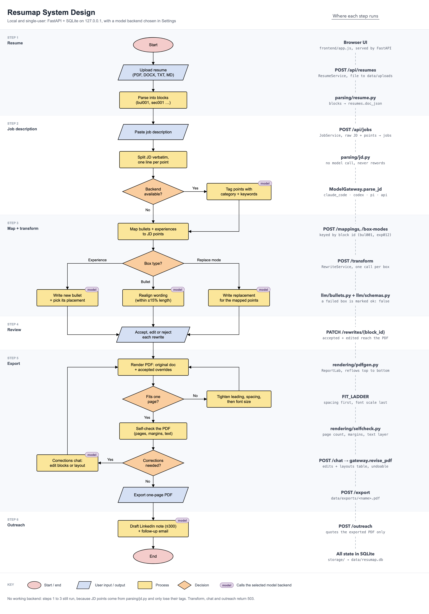
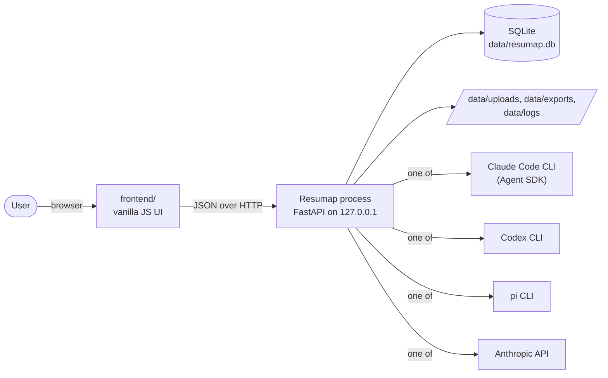
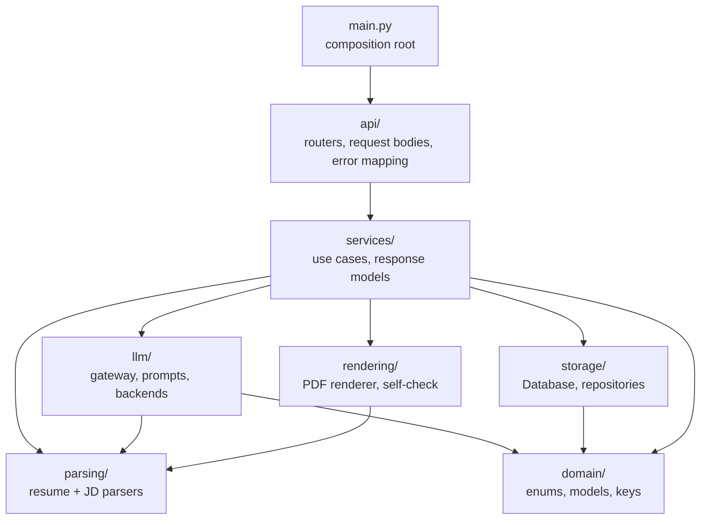
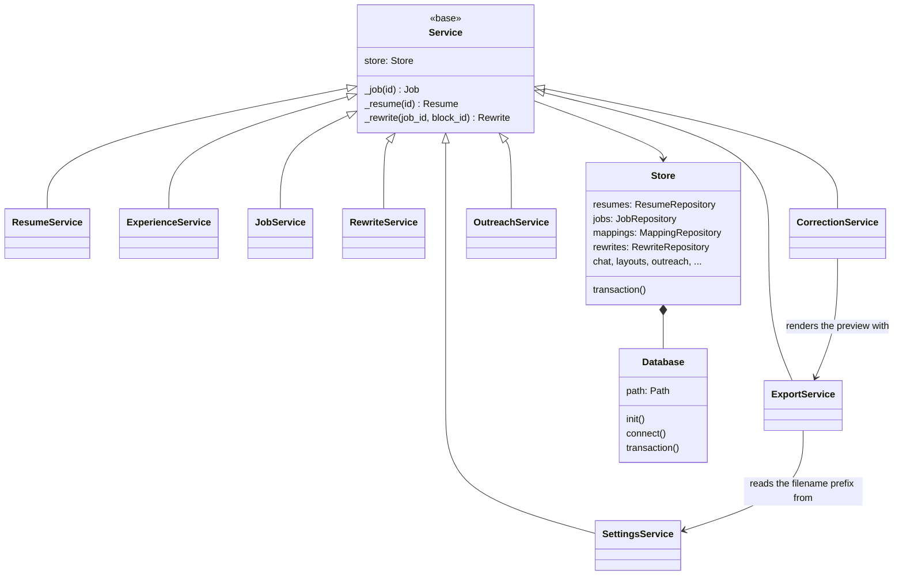
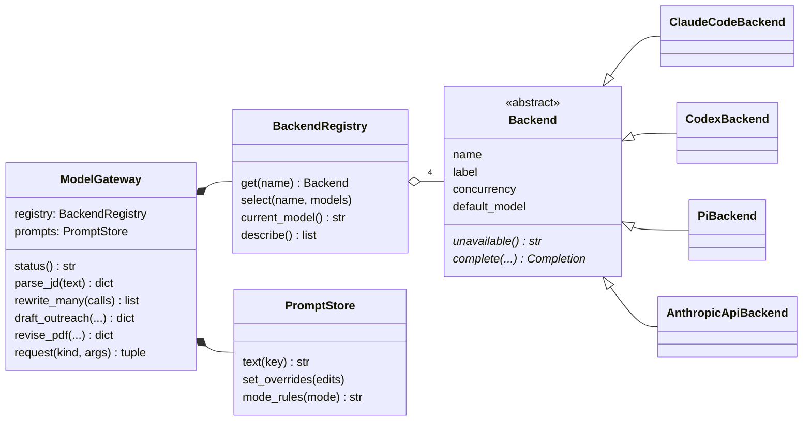
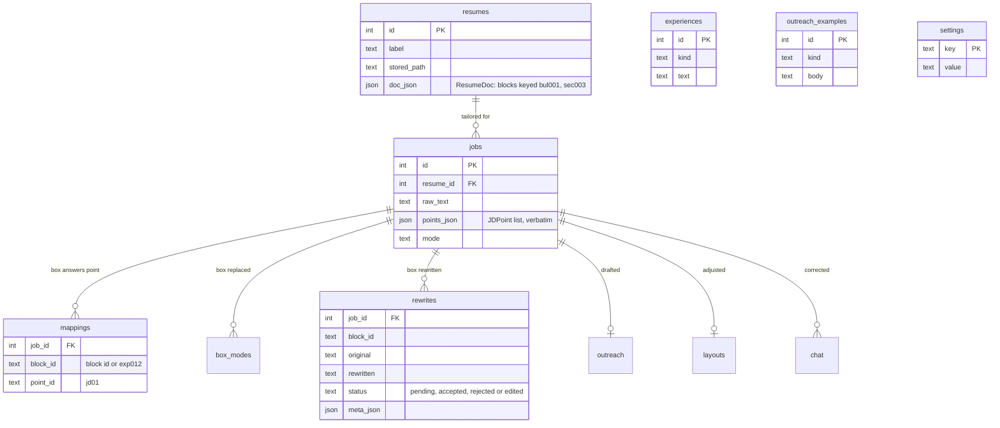
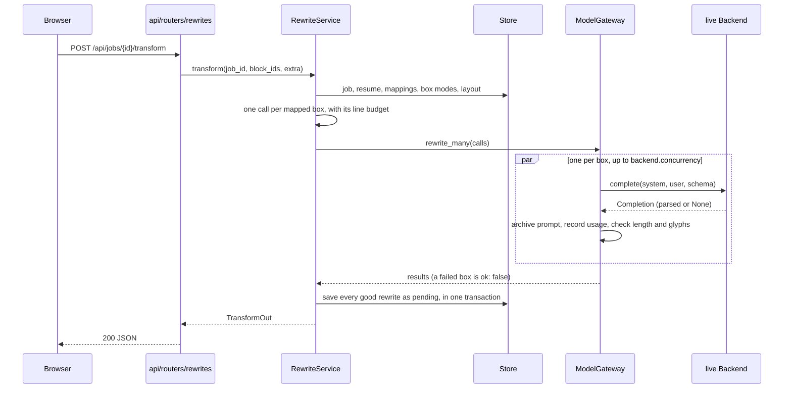
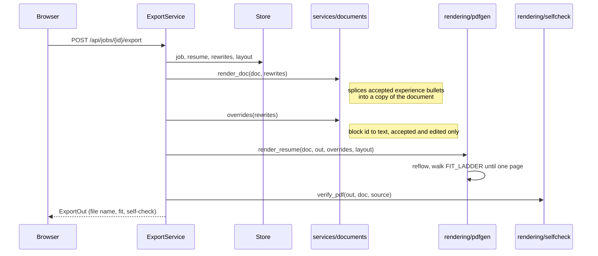

# Resumap architecture

Resumap is a local, single-user web app. One Python process serves a small
browser UI and a JSON API on `127.0.0.1`, keeps everything in one SQLite file,
and reaches a language model through whichever backend the user picked. This
document is the design: the high-level shape first, then the classes, the data
and the two request paths that matter most, then the rules the code keeps.

## 1. Context

Nothing is multi-user: there are no accounts and no authentication, and the
server binds to loopback. The model is optional for the first three steps
(upload, job description, map) and required for the rest.

## 2. Layers

Each package may import only the packages below it. `tests/test_architecture.py`
reads every module's imports and fails the build on a crossing, and on any
`fastapi` or `starlette` import outside `api/`.

| Package | Owns | Knows nothing about |
|---|---|---|
| `domain/` | the vocabulary: `str` enums, entity and document models, the experience-key rule | everything else |
| `parsing/` | PDF/DOCX/TXT to classified blocks; JD to verbatim points; the parse report | storage, models, HTTP |
| `rendering/` | the parsed document plus overrides to a one-page PDF; the export self-check | storage, models, HTTP |
| `storage/` | the schema, connections, transactions, one repository per table group | HTTP, models |
| `llm/` | prompts, response schemas, the `ModelGateway`, the backends | storage, HTTP |
| `services/` | every use case and what it returns; refusals as `ServiceError`s | HTTP |
| `api/` | turning HTTP into service calls and service errors into status codes | SQL, prompts |
| `main.py` | reading configuration and wiring one of everything together | business rules |

## 3. Classes

### Services and storage

### The model layer

`JobService`, `RewriteService`, `CorrectionService` and `OutreachService` are
the services that hold the `ModelGateway`. `Services` (in `services/__init__.py`)
is a frozen dataclass holding one of each service, built by `Services.build`.

Every collaborator arrives through a constructor. `create_app(paths, registry)`
builds one `Store`, one `ModelGateway` and one of each service; a test passes
its own `Paths` and a registry of fakes, and nothing is monkeypatched.

The domain models split in two:

* **Entities** (`Resume`, `Job`, `Rewrite`, `Experience`, `OutreachDraft`,
  `OutreachExample`, `ChatMessage`, `Layout`) mirror table rows and are strict:
  an unexpected field means the table and the model have drifted.
* **Documents** (`ResumeDoc`, `StoredBlock`, `Run`, the `*Meta` blobs) are
  stored as JSON and are tolerant readers: unknown keys pass through, so a
  blob written by another version round-trips byte for byte.

Behaviour lives with the data it is about: `RewriteStatus.included`,
`Rewrite.in_export`, `Job.summary()`, `ResumeDoc.as_dict()`.

## 4. Data

`experiences`, `outreach_examples` and `settings` are global, not per job.
Deleting a resume cascades to its jobs, and a job to everything filed under
it. An experience is mapped and rewritten under `experience_key(id)`
(`exp012`), which cannot collide with a parsed block id because no block kind
starts with "exp".

## 5. Two request paths

### Transform: mapped boxes become rewrites

### Export: the original document plus accepted wording

## 6. Rules the code keeps

These are the invariants the rest of the app depends on. Each one is tested.

1. **JD points are verbatim.** `parsing/jd.py` splits one line per point and
   never rewords, merges, reorders or de-duplicates. The model only labels
   points; `JDTags` has no text field, and a keyword that is not a substring of
   its point is dropped.
2. **Block ids are the join key.** Mappings, rewrites and export overrides are
   all keyed by the parsed block id, so re-parsing a resume invalidates them.
3. **Export applies overrides; it never edits the stored document.** Only
   `accepted` and `edited` rewrites reach the PDF. Every other block keeps its
   source text byte for byte, so a half-finished review still exports.
4. **An untouched upload re-renders line for line.** Every block on the same
   number of lines as the source, one page, at most a trace of compression.
5. **Anything a rewrite introduces is declared.** A claim not in the original
   must appear in `substitutions` with `grounded: false`, which the review step
   shows as "Introduced, not in your original".
6. **Prompts do not change by accident.** `tests/golden/prompts/` pins every
   (system, user) pair byte for byte, and the Map step's preview is built by the
   same function as the call, so it cannot drift from what is sent.
7. **Failure is data.** A backend returns `parsed=None` rather than raising;
   one failed bullet is reported and never blocks its siblings; with no backend,
   upload, JD parsing and mapping still work.
8. **Resume and JD text never reach the metadata log.** `data/logs/resumap.jsonl`
   gets lengths and hashes (`obs.tmeta`); verbatim prompts go only to the
   size-capped prompt archive, which can be switched off.

## 7. Errors

Services raise one of five refusals, and `api/errors.py` alone decides the
status. Every error body is `{"detail": "<one readable sentence>"}`, which the
UI shows as the message.

| Raised by a service | Status | Meaning |
|---|---|---|
| `NotFound` | 404 | the job, resume, rewrite or example does not exist |
| `Invalid` | 400 | well-formed, but cannot be done as asked |
| `Conflict` | 409 | would undo a later change (undoing an older correction) |
| `Unavailable` | 503 | needs a model and the live backend cannot run |
| `UpstreamFailed` | 502 | the model answered with nothing usable |
| request validation | 422 | a body failed its schema, e.g. an unknown status |

## 8. Consistency

Each repository call opens a connection, commits and closes it, unless it runs
inside `store.transaction()`. There, every call joins one shared connection
(held in a `ContextVar`, so per thread and per task), and the block commits
together or not at all; a nested transaction joins the outer one. Every
multi-step write uses one: saving a transform, dropping points and unwiring
them, accept-all, applying or undoing a correction, deleting an experience.

## 9. Testing

The suite is characterization-first: it pins what the app does, so a change
has to show what it changed.

| Kind | Where | What it guards |
|---|---|---|
| snapshots | `tests/golden/` | parser output per format, every prompt byte for byte |
| workflow | `test_api_workflow.py` | every route, driven the way the UI drives it |
| degradation | `test_degradation.py` | no backend, bad replies, a write failing halfway |
| contract | `test_contract.py` | routes declare responses; stored rows fit the models |
| architecture | `test_architecture.py` | the layering in section 2 |
| units | `test_llm.py`, `test_render.py`, `test_storage.py`, `test_jd_split.py` | each layer on its own |

Every model call in the suite goes to `tests/fakes.FakeBackend`, and every test
gets its own storage from `create_app(paths, registry)`. The sample resume is
fictional and generated at test time. Known defects are strict `xfail`s, so
fixing one fails the run until its marker is removed.

## 10. Extending

* **A new route**: a method on the right service returning a model from
  `services/results.py`, then a thin handler in `api/routers/`. Refuse with a
  `ServiceError`, never an HTTP exception.
* **A new model call**: a response schema in `llm/schemas.py`, a pure builder
  for its message, a `ModelGateway` method that validates what comes back, and
  a snapshot in `tests/test_prompts_golden.py`.
* **A new backend**: a `Backend` subclass in `llm/backends/` that takes its
  configuration in its constructor, registered in `default_registry()`.
* **A new column**: add it to the table in `storage/schema.py` and to
  `ADDED_COLUMNS`, since `CREATE TABLE IF NOT EXISTS` never alters an existing
  table; then the entity model, which is strict and will fail until it matches.
